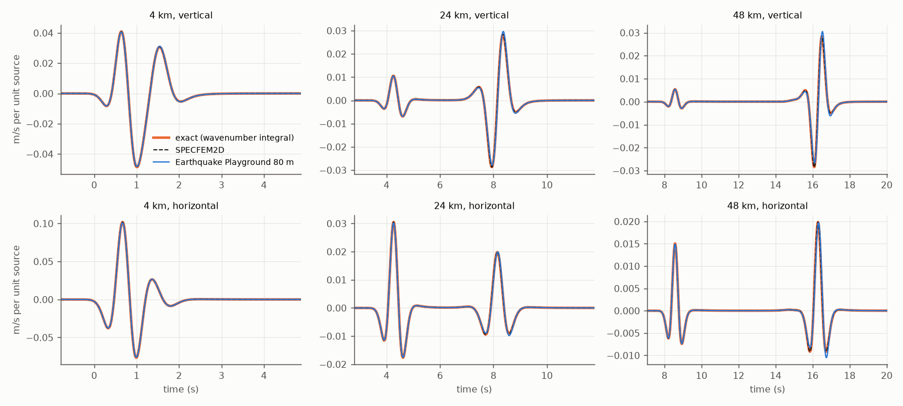
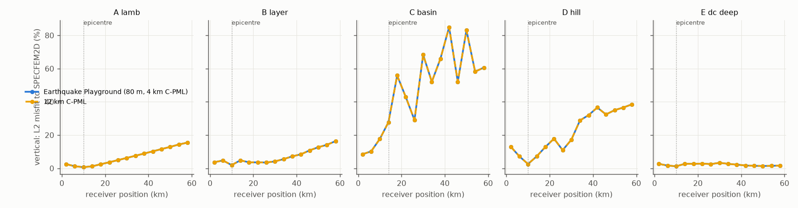
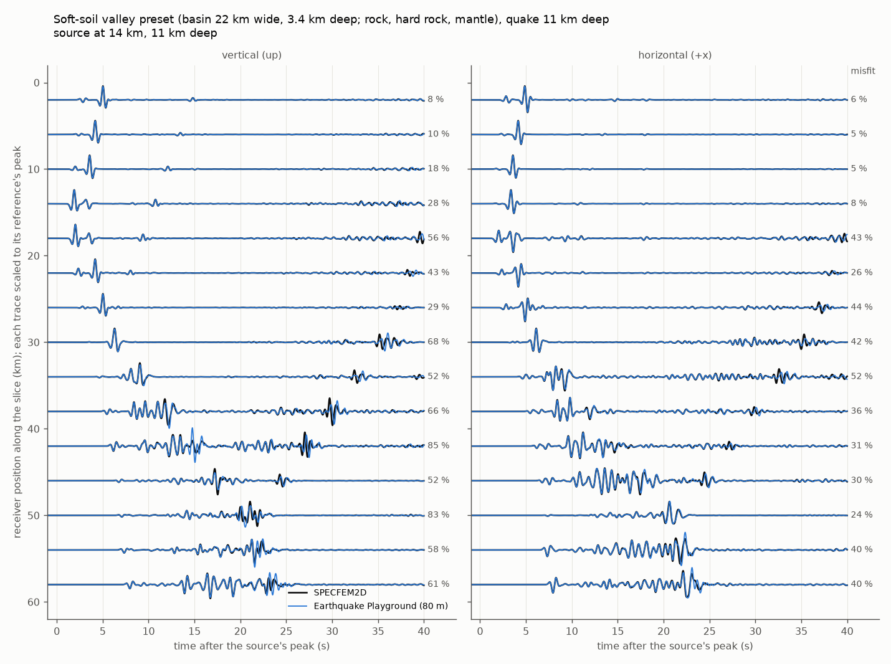
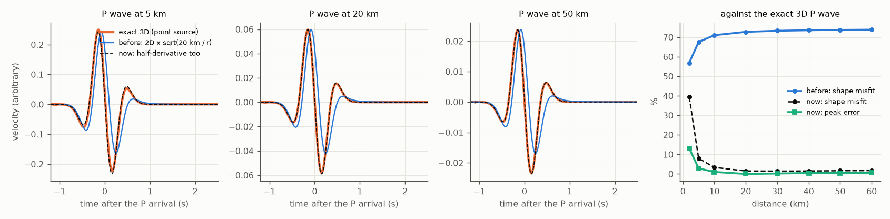

# Validation of Earthquake Playground's wave engine

Earthquake Playground's engine (`src/sim.ts`, `src/sim.wgsl`) was checked against **SPECFEM2D** and an **exact solution of
Lamb's problem**. The setup matches the Quake view: P-SV, a 1.1 Hz Ricker source, the app's rocks, 80 m cells and
a 50-cell sponge. Five cases were run, each with 15 surface receivers 4 km apart, and every record runs 40 s.

## After the fixes (2026-10-17)

These fixes went into the engine and the seismograms after the first validation (below):

1. **C-PML in place of the sponge** (`sim.wgsl`, `sim.ts`): a convolutional perfectly matched layer (Komatitsch
   and Martin 2007) on the same 50 cells, with damping per second, so it no longer depends on the time step.
   Settings: quadratic damping for a 10⁻⁴ reflection, α = π f₀.
2. **The shear part of the source is centred correctly:** it is weighted around the cell corner, where sxz lives,
   instead of half a cell off.
3. **2D-to-3D conversion in the seismograms** (`views/quake.ts`, `readRecords`): each record is half-differentiated
   (causal Grünwald–Letnikov filter, gain 1 at 1.1 Hz) before the √(20 km/r) scaling.

A fourth change was tried and **reverted**: keeping fourth order along a flat surface (second order only in the
direction whose stencil reaches air). It improved the valley (40 → 32 %) and the hill. But in the Inside the Earth
view, after about 4.5 hours of simulated time, the round, stair-stepped surface of the planet made it unstable:
the waves grew 4× every 30 minutes. A higher-order free surface needs a stable formulation, not a stencil switch;
see items 2 and 3 of the list of fixes below.

| Case | misfit median (max), before | **after** | peak ratio | lag max | EM | PM |
|---|---|---|---|---|---|---|
| A Lamb | 6.2 % (17 %) | **4.9 % (16 %)** | 0.99–1.07 | 20 ms | 4.9 → 1.6 % | 1.2 → 1.2 % |
| B soft layer | 8.6 % (23 %) | **6.1 % (22 %)** | 0.94–1.01 | 20 ms | 5.6 → 3.4 % | 2.0 → 1.4 % |
| C soft-soil valley | 40.2 % (85 %) | **40.1 % (85 %)** | 0.65–1.32 | 66 ms | 15.5 → 14.6 % | 10.5 → 10.3 % |
| D hill | 21.4 % (44 %) | **17.6 % (39 %)** | 0.91–1.20 | 40 ms | 13.3 → 8.7 % | 4.8 → 4.4 % |
| E thrust 10 km deep | 8.1 % (32 %) | **1.9 % (3 %)** | 0.96–0.99 | 1 ms | 8.2 → 1.5 % | 1.3 → 0.2 % |

The comparison is the same as below: Earthquake Playground exactly as the app runs it (80 m cells), against
SPECFEM2D.

- **Echoes from the absorbing layer are gone.** A 150-cell PML gives the same traces as the 50-cell one to within
  0.04 % of the peak, where the sponge's echoes were a median 2–6 % and up to 22 %.
- **This fixes the deep quake (E) almost completely.** Its error was mostly the bottom echo. It also helps A, B and
  D, whose remaining errors grow with distance.
- **What is left is grid dispersion of surface waves,** strongest in soft soil and on staircase topography (C, D).
  It needs more cells per wavelength or a better free surface. The research engine QuakeSim is meant to do this
  properly; this app stays a fast teaching tool.
- **The 2D-to-3D conversion,** with the app's own filter, now matches the exact 3D pulse shape to 1.4–3.4 % from
  10 to 60 km (8 % at 5 km), against 71–74 % before, with peaks within 1 %.
  - At 2 km it is still 40 % off. A record there starts at the source's peak and misses the beginning of the
    pulse, and the half-derivative is a far-field correction.
  - Peaks at 20 km move by under 5 %, so the magnitude calibration `K` was left as it was.
- **Not changed:** the grid (80 m), stiffened soils and attenuation. The wave-speed-dependent 1/√c factor of the
  3D conversion was also left out, since a record mixes P, S and surface waves.
- **Checked in the app:** the Quake view (explosion and fault rupture) and the Inside the Earth view (12 hours,
  stable: the waves fade and the record stops by itself after about 9 hours for magnitude 7).
- **No fine-grid numbers:** the 26.7 m runs were made with the reverted surface rule and are set aside in
  `out/qv_stale_fine/`. They were not rerun, because they are heavy.

The sections below are the first validation, before these fixes. Its numbers are kept in
`out/metrics_before_fixes.json`; the figures show the code after the fixes.

## The answer in short (before the fixes)

- **The engine solves the right equations, with the right amplitudes, arrival times and radiation patterns.** Near
  the source and in the first arrivals, Earthquake Playground agrees with SPECFEM2D and the exact solution to a few per cent.
  Absolute amplitudes, with no fitting, agree within 1–8 % in the homogeneous, layered and deep-quake cases. Arrival
  times agree within 20 ms (cross-correlation lag), and the median first-arrival pick differs by 2–11 ms.
- **The main error is grid dispersion of surface waves at 80 m.** It grows with distance: from 1–5 % near the
  source to 15–20 % L2 misfit at 48 km on rock (Rayleigh wavelength 2.7 km, about 33 cells). It is much larger
  where waves are slow or the surface is a staircase. In the soft-soil valley the median misfit is 40 % and the
  worst trace reaches 85 %, because waves trapped in the basin drift out of phase. Over and behind the hill the
  misfit is 21–44 %. On a 3× finer grid these errors fall to 13 % (valley) and 7 % (hill). The engine converges;
  80 m is simply too coarse for 1.6 km/s soil and for staircase topography at frequencies up to 3 Hz.
- **The sponge reflects.** On the 80 m grid its echoes are a median 2–6 % of the trace's peak, and up to 15–22 %
  for receivers near the edges. The sponge damps by a fixed factor per time step, so on a finer grid (shorter
  steps) it absorbs harder and **reflects about twice as much**.
- **The 2D-to-3D conversion gets the amplitude right but not the pulse shape.** The app multiplies the 2D record by
  √(20 km/r). That gives peaks within 1 % beyond 10 km (10 % at 2 km). But the pulse keeps the 2D shape: a 45°
  phase shift and a longer tail. Against an exact 3D wave, the shape misfit is **73 %**. A half-derivative
  conversion brings it to 1–2 %.
- **Things that hardly matter:** spreading the source over a few cells (0.5 % misfit, 0.5 % lower peaks) and
  float32 arithmetic (not visible at this level).

| Case | Earthquake Playground as in the app: misfit median (max) | first 9 s | peak ratio | lag max | onset median | EM | PM | 26.7 m cells + 12 km sponge: misfit median (max) |
|---|---|---|---|---|---|---|---|---|
| A Lamb, explosion 1 km deep | 6.2 % (17 %) | 5.0 % | 0.99–1.07 | 20 ms | 2 ms | 4.9 % | 1.2 % | 3.0 % (9 %) |
| B soft layer over rock, dip-slip 6 km deep | 8.6 % (23 %) | 5.7 % | 0.92–1.03 | 16 ms | 4 ms | 5.6 % | 2.0 % | 4.3 % (6 %) |
| C soft-soil valley preset, quake 11 km deep | 40.2 % (85 %) | 10.4 % | 0.65–1.33 | 64 ms | 11 ms | 15.5 % | 10.5 % | 12.8 % (29 %) |
| D Gaussian hill 2 km high, explosion 2 km deep | 21.4 % (44 %) | 16.7 % | 0.91–1.20 | 40 ms | 2 ms | 13.3 % | 4.8 % | 6.9 % (16 %) |
| E thrust 10 km deep | 8.1 % (32 %) | 4.1 % | 0.96–0.99 | 20 ms | 3 ms | 8.2 % | 1.3 % | 4.1 % (15 %) |

The table compares Earthquake Playground with SPECFEM2D, both components, over every receiver whose reference peak is at least
3 % of the largest in its component. The metrics are:

- **misfit:** ‖QV − SPECFEM2D‖ / ‖SPECFEM2D‖ over the whole 40 s record.
- **first 9 s:** the same over the first 9 s of signal.
- **peak ratio:** QV's peak divided by SPECFEM2D's.
- **lag:** the cross-correlation time shift.
- **onset:** the difference between first-arrival picks (at 5 % of the peak).
- **EM, PM:** the single-valued envelope and phase misfits of Kristeková et al. (2006), 0.2–3 Hz, from ObsPy.

The basin's onset maximum (0.9–1.3 s) is a pick on a weak precursor, not a timing error, so the table gives the median.

**Is the reference right?** For case A, SPECFEM2D agrees with the exact solution to **0.17 % median misfit** (0.24 %
at worst). Its peaks are within 0.3 %, its EM is 0.10 % and its PM 0.02 %. That confirms SPECFEM2D's mesh and time
step, the source scaling, the sign conventions and the receiver placement. Every number above is therefore
Earthquake Playground's error.

## Cases

All the materials are the app's (`src/ground.ts`). The rock types are:

| Material | Vp (km/s) | Vs (km/s) | ρ (g/cm³) | Note |
|---|---|---|---|---|
| Soil | 2.8 | 1.6 | 1.9 | stiffened, as in the app |
| Rock | 5.6 | 3.2 | 2.6 | |
| Hard rock | 6.6 | 3.75 | 2.9 | |
| Mantle | 7.6 | 4.3 | 3.3 | |

The receivers are at x = 2, 6, …, 58 km, 40 m under the surface: the centre of Earthquake Playground's top cell. The source is
the integral of a 1.1 Hz Ricker as moment, which is what Earthquake Playground injects into the stress. It sits at a cell
centre, so it is exactly in the same place in both codes.

| | Model | Source |
|---|---|---|
| A | homogeneous rock half-space | explosion, x = 10 km, 1.00 km deep |
| B | 2 km of soil over rock | 60° normal fault, x = 10 km, 6.04 km deep |
| C | the *Soft-soil valley* preset: soil basin 22 km wide and 3.4 km deep at x = 40 km; rock to 12 km, hard rock to 25 km, mantle | 60° normal fault, x = 14 km, 11 km deep (the preset's quake) |
| D | rock half-space with a Gaussian hill 2 km high (e-folding half-width 5 km) at x = 34 km | explosion, x = 10 km, 2.04 km deep |
| E | homogeneous rock half-space | 30° thrust, x = 10 km, 10.04 km deep |

## Figures

Record sections overlay the two codes. Each trace is scaled to the peak of its SPECFEM2D trace; the number at the
right is that trace's misfit.

- **A**, with the exact solution: [figures/A_lamb.png](figures/A_lamb.png), and close-ups at 4, 24 and 48 km in
  [figures/A_lamb_zoom.png](figures/A_lamb_zoom.png).
- **B:** [figures/B_layer.png](figures/B_layer.png).
- **C:** [figures/C_basin.png](figures/C_basin.png).
- **D:** [figures/D_hill.png](figures/D_hill.png).
- **E:** [figures/E_dc_deep.png](figures/E_dc_deep.png).

Misfit along the receiver line. The variants that tell the error sources apart are described in the next section.

## What causes the differences

Earthquake Playground's engine was run in four set-ups on the same cases. Only the run configuration changed, never the
engine:

| Run | Cells | Sponge | A | B | C | D | E |
|---|---|---|---|---|---|---|---|
| the app | 80 m | 50 cells, 4 km | 6.2 / 17 | 8.6 / 23 | 40 / 85 | 21 / 44 | 8.1 / 32 |
| wider sponge | 80 m | 150 cells, 12 km | 5.0 / 15 | 7.4 / 21 | 40 / 85 | 18 / 39 | 3.7 / 20 |
| finer grid | 26.7 m | 4 km | 7.6 / 18 | 7.9 / 17 | 16 / 30 | 12 / 38 | 12.5 / 55 |
| both | 26.7 m | 12 km | **3.0 / 9** | **4.3 / 6** | **13 / 29** | **6.9 / 16** | **4.1 / 15** |

Each cell gives the median / maximum misfit to SPECFEM2D, in per cent. The finer grid is 3× finer, so the cell
centres, and with them the source, stay put. Its unit source carries 1/9 of the moment, and the comparison
corrects for that.

**1. Grid dispersion and the free surface: the largest error.**

- On rock, the error grows steadily with distance. It is a trailing ripple on the Rayleigh wave, the typical
  shape of grid dispersion, and not a delay: the lag stays under 20 ms over 48 km, a speed error under 0.15 %.
- Within ±0.8 s of the Rayleigh pulse, the misfit to the exact solution falls from 5–19 % on the 80 m grid to
  1–2 % on the 26.7 m grid.
- Earthquake Playground is fourth order in space, but **second order within two cells of the air** and second order in time.
  Rayleigh waves live in exactly those cells, so they get the low-order stencil. The vacuum formulation also gives
  the surface node half a cell of rock.
- In soil (1.6 km/s), the shortest S wavelength at 3 Hz is only 6.7 cells. The valley's trapped surface waves
  cross many wavelengths and drift out of phase: the first 9 s still match (10 % median), but the late coda does
  not.
- On the hill, the 80 m staircase surface scatters and slows the waves. The misfit is 25–34 % on the horizontal
  component on the hill's flanks and 30–44 % on the vertical beyond it. At 26.7 m with the wide sponge it is 1–16 %.
- Even the fine grid leaves 13 % in the basin and 7 % at the hill. A low-order, staircased free surface converges
  slowly. Some of the basin remainder may also come from SPECFEM2D's model: it reads the basin from a 25 m grid,
  so its edge is smoothed over 25 m, where Earthquake Playground's is a staircase of whole cells.

**2. The sponge: the second largest error.**

- With a 12 km sponge, the misfit falls in every case: by half in E (8.1 → 3.7 % median), and by 15–20 % in A,
  B and D.
- On the 80 m grid, the echoes the 4 km sponge adds are a median 2–6 % of the trace's peak, and up to 15–22 %
  at receivers near the edges and above a deep source. The bottom echo returns to the surface while the direct
  waves are still small.
- The sponge multiplies the fields by a fixed profile **each step**. On the fine grid, with 3× more steps per
  second, the same 4 km sponge damps 3× faster, which is a sharper contrast, so its echoes double: a median
  3–12 % and up to 44 %. That is why the "finer grid" row is worse than the app in E.
- This is a design flaw, not a tuning problem. Any change to the time step changes the sponge, and a stronger
  `VMAX` would do the same.

**3. The source spread: negligible.** Spreading the source over the cells with r ≤ 3 (weights exp(−r²/2)) changes
the exact solution by 0.55 % median misfit and lowers peaks by 0.5 %. The shear part of a double couple is placed at
the cell corner's stress (sxz) but weighted around the cell centre, so it sits half a cell (57 m) off. This was not
measured on its own. The double-couple cases (B, E) still reach 4 % on the fine grid, so its effect is small.

**4. Stiffened soft soils: a limit of the model, not the solver.** Both codes used the app's 1.6 km/s soil, so this
validation does not test real soft soil. Real clay and sand (Vs 0.1–0.5 km/s) would need 10–25 m cells at 3 Hz,
or a lower top frequency. With the dispersion measured above, 80 m cells would make such soils badly wrong.

**5. 2D-to-3D conversion: changes the shape, not the peak.** `threed.py` compares exact P waves of an explosion
in a whole space, from a line source (2D) and from a point source (3D). The app's √(20 km/r) gives the right decay
for body waves (1/r) and for surface waves (1/√r). Calibrated at 20 km, its peaks stay within 1 % from 10 to 60 km,
and within 10 % at 2 km.

But a 2D pulse is the 3D pulse integrated by half an order. It is 45° out of phase, lags by about 0.1 s and has a
longer tail. Its spectrum also peaks lower: 1.23 Hz in 2D against 1.35 Hz in 3D. So the app's 3D traces differ in
shape from real 3D ones by 73 %, at every distance. The correct far-field conversion is
u₃D(ω) ≈ √(ω / 2π c r) · e^(−iπ/4) · u₂D(ω), which brings the shape misfit to 1–2 % beyond 10 km. It also scales
each wave by 1/√c, so calibrating on one wave type leaves the others off by √(c₁/c₂). For example, if P waves are
matched, S is 1.32× too weak relative to P, and Rayleigh waves are about 1.4× too weak. This affects real-unit
amplitudes, intensities and the look of the traces, not the 2D physics.

## Fixes, in order of impact

1. **Replace the sponge with a convolutional PML** (C-PML: Komatitsch and Martin 2007; Martin, Komatitsch and
   Gedney 2008 for grazing waves). Interim fix: define the sponge's damping per second (exp(−d(x)·dt), with d in
   1/s), so it no longer depends on the time step, and widen it.
   - Effect: removes median echoes of 2–6 %, and the 15–22 % near the edges.
   - Cost: about 2× the memory for the stress and velocity in a 10–20 cell border.
2. **Better free surface and topography.**
   - Use a fourth-order free surface for flat ground: the stress image of Levander (1988), or the AFDA of Kristek,
     Moczo and Archuleta (2002).
   - Or keep the vacuum method but use the fourth-order stencil up to the surface, with one-sided coefficients.
   - For topography, a curvilinear grid (Hestholm and Ruud 1998) or a spectral-element core gives a smooth
     surface. A staircase needs about 3× finer cells for the same accuracy.
   - Effect: removes most of the Rayleigh-wave error on rock (17 % → about 3 % at 48 km) and on the hill.
3. **Enough cells per wavelength in slow material.** Either refine the grid where Vs is low, or cap the source
   frequency so the shortest S wavelength spans at least 10–12 cells (fourth order) or 20 cells (second order
   near the surface).
   - Measured cost: the 26.7 m grid (9× the cells, 3× the steps) ran 40 s of simulated time in 45 s on an M4 Pro,
     about real time.
   - A 40 m grid (4× the cells, 2× the steps) should cut the basin and hill errors roughly in half (not run
     here) and still run several times faster than real time.
   - Effect: the basin goes from 40 % to about 13 %.
4. **A correct 2D-to-3D conversion for the real-unit seismograms:** a half-derivative (√ω, −45°) filter and
   1/√(c r), applied with c for the dominant wave or as a frequency-domain 2.5D correction (Bleistein 1986;
   Miksat, Müller and Wenzel 2008). Effect: the pulse shape goes from 73 % misfit to 2 %.
5. **Frequency-dependent attenuation** (generalized standard linear solids, memory variables; Emmerich and Korn
   1987; Moczo and Kristek 2005).
   - Not tested here: both codes ran without it.
   - The app's per-cell loss factor is a frequency-independent decay; real Q damps high frequencies more.
   - This is required before comparing with real records, and attenuation would also hide part of the
     dispersion ripple.
6. **Small ones.** Weight the shear-stress source around the cell corner (removes the 57 m offset), and normalise
   the source's spread to a fixed moment.
   - Today the moment per unit source scales with h² and with the 6.21 weight sum (M₀ = 3.98 × 10¹³ N·m/m per unit
     on the 80 m grid).
   - This matters if the grid ever changes, because the magnitude calibration `K` would silently change with it.

## How it was run

- **SPECFEM2D 8.1.0**, git commit `abf3196e3192af3343f2b402c82f34205577e672` (2025-12-17), master branch.
  - Built with gfortran (Homebrew) by `./configure FC=gfortran CC=gcc && make all`, serial, in
    `~/Desktop/Research/specfem2d`. Run directories are in `~/Desktop/Research/specfem2d_work/runs/<case>`.
  - Mesh: degree-4 spectral elements of 250 m (about 8 GLL points per shortest S wavelength in the soil at
    2.75 Hz). The domain is x = −8 to 69.5 km and 36 km deep, with 4-element C-PML on the left, right and bottom
    and a free surface on top. Newmark, dt = 2 ms (CFL at most 0.35), no attenuation.
  - Material boundaries are mesh boundaries. The basin is read from a 25 m tomography grid in the top 12 km, and
    the hill is the mesh's own smooth surface.
  - Source: a point moment tensor with time function type 2 (first derivative of a Gaussian, the integral of a
    Ricker). Its factor is −M₀, with M₀ the moment of Earthquake Playground's unit source. Mxz changes sign because SPECFEM2D's
    z points up.
  - Five runs take about 6 min, in parallel.
- **Earthquake Playground**, with `src/sim.ts` SHA-256 `426b255b8f968093…` and `src/sim.wgsl` `ebf43fb922e103b7…` (2026-10-17).
  - `qv/runner.ts` drives the real `Sim` class in headless Chrome (WebGPU, Apple M4 Pro). It uses the Quake view's
    grid, sponge, time step (4.74 ms), source and seismometer cells, and saves the raw 2D velocity records (no
    magnitude scaling, no √(20/r)).
  - These are the records the app's SAC files are made from. The app only rescales them linearly and resamples
    them to 100 samples per second, and that conversion is assessed separately (item 5 above).
  - Each 40 s run takes 1.1–1.3 s at 80 m, 45 s at 26.7 m and 70–90 s at 26.7 m with the 12 km sponge.
- **Exact solution** (`lamb.py`): discrete-wavenumber integration for an explosive line source in a half-space
  (Bouchon 1981). It is converged to 4 × 10⁻⁹ of the peak (halving dk and raising k_max changes nothing), and it is
  computed for both a point source and Earthquake Playground's spread source.

### Files

| File | What it does |
|---|---|
| `cases.py` | The cases, defined once for both codes. It writes `out/cases.json` and the Earthquake Playground grids (`out/grids/*.f32`, 0.5 GB, can be regenerated). |
| `specfem.py` | Sets up and runs SPECFEM2D (`--run`). |
| `vite.config.ts`, `qv/runner.html`, `qv/runner.ts`, `run_qv.sh` | Run Earthquake Playground's engine headless (a second Vite server on port 5178 with a `/__save` endpoint, plus headless Chrome). |
| `lamb.py` | The exact Lamb solution for case A. |
| `threed.py` | The 2D-to-3D conversion test. |
| `compare.py` | The metrics (`out/metrics.json`, `out/metrics.csv`, per receiver and component) and the figures. |
| `run_all.sh` | Everything, end to end, in about 20 min. |

Python: a venv with numpy, scipy, matplotlib and ObsPy (`~/Desktop/Research/specfem2d_work/.venv`). Rerun after an
engine change with `./run_qv.sh && $PY compare.py`; the SPECFEM2D runs do not need to be repeated.

**The 26.7 m runs are heavy.** At 9× the cells, each one keeps the GPU fully busy for minutes, and on a laptop that
can freeze the screen (the display shares the GPU). So `cases.py` leaves them out unless you run it with `--heavy`.
The runner also works in batches of 100 steps and waits for the GPU between them. The 26.7 m results above, after
the fixes, are from A–D (E's 26.7 m run with the 12 km PML was stopped).

### Caveats

- SPECFEM2D's accuracy was proven only in case A (against the exact solution). The other cases use the same mesh
  size and time step, with soil sampled at 8 GLL points per wavelength.
- On the 26.7 m grid, the receivers are 13 m deep instead of 40 m, and the source spread is 3× narrower. Both
  effects are well under 1 %.
- Case D's receivers follow the smooth surface in SPECFEM2D and the staircase in Earthquake Playground. They differ in depth
  by up to 40 m.
